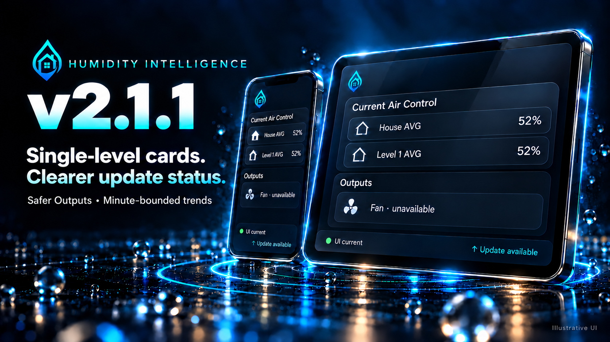

# Humidity Intelligence v2.1.1

**V2.1.1 Stable — single-level dashboards and clearer update status.**
These notes describe the complete update from v2.1.0 and preserve the reviewed
v2.1.1-rc.1 runtime and generated cards.
[Release and downloads](https://github.com/senyo888/humidity-intelligence/releases/tag/v2.1.1) · 24 October 2026.

## Dashboards that follow your configuration

Single-level homes can use the V2 Mobile and Tablet layouts without adding a dummy
second level. Humidity and temperature chips follow configured telemetry and saved
Options. Unconfigured levels disappear; configured sensors that become unavailable
remain visible. A genuinely missing required mapping still prevents a verified export.

Thanks to [@Ak1Sun](https://github.com/Ak1Sun) for reporting
[#129](https://github.com/senyo888/humidity-intelligence/issues/129).

## Separate card and software status

The left footer compares your card's declared UI revision with the compatible backend target.
Optional HACS-reported update information appears separately on the right.
**↑ Update available** is shown when the provider reports it. Routine no-update
information stays in details; skipped, in-progress and unverified states stay visible.

Open the footer for both sets of evidence. **View update** opens Home Assistant's
existing update details when the source is still valid; it does not download,
install or restart anything. HACS downloaded/available versions do not prove
loaded code or a fresh check for releases. Missing HACS evidence remains unverified
and cannot block HI's control engine.

## More reliable readings and reports

- Native Outputs safely displays device text and shows percentages only for finite
  numbers, retaining the existing unavailable and fallback behavior.
- Calculated temperature trends retain the latest actual reading per minute over
  one hour, at most 61 points. Missing minutes are not filled. This changes event
  weighting and can affect slopes and slope-dependent decisions. Provided slopes,
  lane priority, CO protection and output ownership remain unchanged.
- Self-check telemetry counts follow saved Options when sensors are replaced or
  removed. The correction changes report accuracy, not configuration or control.
- Issue-summary privacy filtering handles heavily decorated text without the
  previous ambiguous repeated matching. Native diagnostics schema/redaction and
  aggregate mapping privacy remain intact.

## Updating and rollback

No configuration or entity migration is required. When installing the final package:

1. Retain the previous complete package and saved Manual-card YAML separately.
2. Install the complete package and fully restart Home Assistant. An integration
   reload alone does not establish that changed Python or manifest metadata loaded.
3. From v2.1.0 or an earlier layout, run `humidity_intelligence.refresh_ui`, export
   with `view_cards` or `dump_cards`, then replace the **complete saved card YAML**.
   Refresh the browser or Companion app if it retains older resources.
4. Confirm the loaded package identity separately from the UI revision and HACS
   provider information. See [diagnostics guidance](../support.md).

Both layouts retain **revision 13**, stamp schema **1** and generator contract **1**.
Existing beta.4 or RC.1 revision-13 cards remain compatible; the Stable version bump
alone requires no replacement. Earlier revisions 1–12 are superseded. Installing HI
does not automatically replace cards already pasted into a dashboard.

Restart/reload resets in-memory Stability history. Rollback restores the previous
complete package, performs a restart, and restores compatible saved cards; revision-13
cards against an older backend may show **UI differs**. A package restore cannot
recover the previous in-memory history.

## Validation and identity

The RC source completed Python, JavaScript, isolated native Home Assistant and
generated-browser validation, full House review, dedicated code review and CodeRabbit
review. Its develop merge passed all checks, including 136 browser cases. Two
arbitrary-touch WebKit cases were unsupported and not run; fixture checks do not
establish physical-device behavior. An earlier WebKit actionability timeout passed
on retry and did not recur in the PR or post-merge run; its underlying cause was
not reproduced.

The Stable package retains those runtime and generated-card bytes. Its changed
manifest and packaged guidance create a distinct package identity, checked separately
through [release governance](../release-governance.md#v211-stable-source-preparation).
Earlier live evidence is beta.4, with insufficient seven-day history and collecting
Stability; it is not final-package installation evidence. Lab/soak evidence remains
advisory and non-blocking. Source promotion, publication and deployment are separate.

## A note from Senyo

For v2.1.1, I wanted to tighten up the parts of HI that need to be clear in day-to-day
use. A single-level home should be able to use the V2 dashboards without adding a
dummy second level. The cards should follow the configuration you have saved and
still show when a configured sensor is unavailable.

I've also made the update information easier to follow. Whether your card's declared
UI revision matches the backend target and whether HACS reports an update are two different
things. The footer keeps those details separate, with more information available
when you need it.

There are smaller corrections underneath that work: safer Outputs text, consistent
temperature trend sampling and self-check counts that follow Options changes. The
trend change can affect slope-based decisions, so it is called out above. HI's
defined priorities, seasonal targets and reason reporting remain central to how it
works.

My aim with this update is to make HI easier to check, easier to maintain and clearer
when something needs attention. The final Stable version keeps the reviewed RC
behavior, with the documentation and upgrade guidance aligned around it.

Senyo
