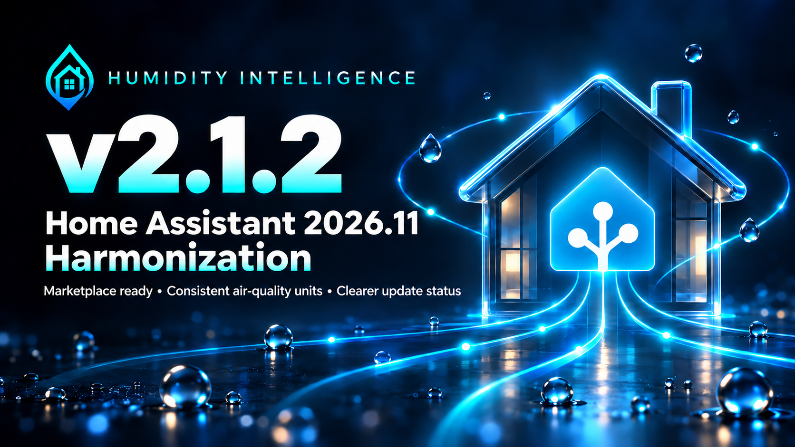

# v2.1.2 — Home Assistant 2026.11 Harmonization

Stable source combines the reviewed v2.1.2-beta.1 implementation with a generated-card correction found during installation validation.
Published Stable remains v2.1.1 until the new release is published. This record
keeps source preparation, instance validation and publication separate.

## Marketplace installation

HI now supplies the named `humidity_intelligence.zip` release asset instead of
requiring the full repository archive. This avoids the oversized download
reported in [#145](https://github.com/senyo888/humidity-intelligence/issues/145).
On Home Assistant 2026.11+, use **Settings → Marketplace**; earlier supported
versions retain HACS. The minimum Home Assistant version remains 2026.5.1.

The update footer recognizes Marketplace and legacy HACS through the registered
HI repository identity. Missing or ambiguous provider evidence remains unverified.
Downloaded versions are separate from loaded code and saved-card compatibility.
Optional dashboard cards never become backend dependencies.

## Thanks to our issue reporters

Thank you to [@Slaybcn](https://github.com/Slaybcn) for reporting the Marketplace
installation failure in [#145](https://github.com/senyo888/humidity-intelligence/issues/145)
and sharing the error logs, and to [@Thorsten1982](https://github.com/Thorsten1982)
for confirming the same problem. Your reports helped identify the release-packaging
failure and shape the installation fix in v2.1.2.

## Consistent air-quality evidence

VOC is normalized to ppb, CO and CO₂ to ppm, and PM2.5 to µg/m³ before control,
aggregation and Stability evaluation. Unsupported units and invalid values are
excluded and exposed in diagnostics. HI does not rewrite sensor sources,
thresholds or historical records; review those against the canonical units.

CO emergency remains the highest-priority lane. Its latch clears only after every
configured source supplies valid readings below the clear threshold throughout a
fresh, continuous two-minute hold. Missing or invalid evidence resets that hold.
The existing thresholds and lane priority remain unchanged.

## Configuration and dashboard continuity

Conditional gate forms preserve hidden settings, explicitly saved supplied-slope
sources retain their identities, and failed platform unloading retains runtime
custody. These corrections are preserved from the tested beta.

Generated cards now remove references to optional air-quality and output sources
that have not been configured, including references inside button-card JavaScript.
An unrelated entity with an old placeholder name can no longer influence these
cards. Configured sources remain visible to validation when missing, unknown or
unavailable; no dummy helpers or relaxed checks are used.

Both V2 layouts advance to **revision 16**, superseding revisions **1–15**, with
stamp schema **1** and generator contract **1** unchanged. The templates and gallery
YAML are unchanged; the generator correction changes exported cards. This stable
transition therefore includes changed component code and requires new exports.

## Updating and rollback

1. Keep the previous complete package, configuration and compatible saved cards.
2. Install the complete release package and fully restart Home Assistant. An
   integration reload alone does not prove that the new package loaded.
3. **From v2.1.2-beta.1, v2.1.1 or earlier:** run
   `humidity_intelligence.refresh_ui`, export the V2 layouts through `view_cards`
   or `dump_cards`, and replace each complete saved Manual-card YAML. Revision-14
   beta cards also need replacement; installing HI does not replace pasted cards.
4. Check that both V2 layouts show revision **16** in the generated stamp and live
   Diagnostics.
5. Verify loaded identity, diagnostics and mapped inputs independently of the
   package manager's version report.

Restart clears in-memory Stability history. No configuration-entry or entity-ID
migration is required. Ambiguous legacy supplied-slope mappings need explicit
correction in Options. See [compatibility and migration](../home-assistant-2026.11.md).

Rollback restores the previous complete package, performs a restart and restores
matching saved cards. Keep backup directories outside `custom_components`.
Older release tags retain their original delivery limitations; see
[exact-tag recovery](../release-packaging.md#earlier-versions-and-current-evidence-limits).

## Validation and publication status

The changed generator passes regression checks for absent optional mappings,
legacy-name collisions, mapped missing/unknown/unavailable inputs, JavaScript
execution and both V2 layouts. The unchanged release checker remains authoritative.
The exact revision-16 package passed the minimal native-instance checks below.
Final Stable-instance acceptance remains blocked at post-restart instance checks;
older successful package results do not substitute for that acceptance.

| Validation route | Recorded result |
| --- | --- |
| Revision-16 source and generated-card regressions | Passed, including configured remaps and legacy-name collisions |
| Exact revision-16 package, fresh minimal HA 2026.10.1 instance | Passed: 12 passes, 3 explained warnings, 0 failures and 1 informational result; all 78 files matched |
| Exact revision-16 package, Stable HA 2026.11.0 | Installed and loaded after one guarded restart; exact files and revision-16 Diagnostics verified read-only. Final acceptance blocked by post-restart instance checks |
| Earlier candidate `2e2792ad`, manual Stable-instance upgrade | Passed on HA 2026.11.0; 13 passes, 3 explained input/history warnings, no failures; revision 14 |
| Published beta, native Marketplace fresh install and upgrade | Passed; upgrade baseline was manually installed v2.1.1 |
| Legacy HACS 2.0.5, HA 2026.10.1: published beta fresh install | Installer passed; all 78 files matched the published asset |
| Legacy HACS replacement over manually loaded v2.1.1 | Installer passed; configuration and 36 entity identities preserved. HACS re-download, not a managed-baseline update notification test |
| Earlier candidate on the isolated legacy instance | Manual ZIP bridge loaded 2.1.2; configuration and identities preserved; revision 14 |
| Final stable tag and draft release asset | Pending promotion, tag and exact-asset verification before publication |
| Published stable, Marketplace discovery and fresh install/upgrade | Pending final publication; beta results do not establish this route |

The current component is
[`0d99f598`](https://github.com/senyo888/humidity-intelligence/commit/0d99f598b46952ec7946dc2ef6b6e64fb2451208),
with ZIP SHA-256
`6059cb5e91cfc54799b2ab967099b2dfa174ccc311fdabcec7e58b28052d4670`.
A new disposable fixture completed the native alert-only setup with no output
mappings or shared credentials. Five generated exports parsed; live Diagnostics
advertised revision 16/schema 1/generator 1. The unchanged release checker found
zero missing optional references. Injecting the 14 legacy entity names no longer
changed the affected JavaScript results. Missing fixture inputs and statistics
history remained warnings; no synthetic healthy readings were added.

All protected active-Lab files, registries and TI work were preserved. The fixture
was stopped and its own authentication removed. The Stable read-only checks also
confirmed package, configuration, entity and saved-dashboard preservation, but do
not close the separate post-restart acceptance blocker. No final Stable pass is
claimed for this package yet.

The earlier Stable candidate's 78 files matched ZIP SHA-256
`a5fc54da591a42f93779b7f501d6012cd653a1779142e2b4e94fad344794809b`.
Its single full restart preserved configuration, entity identities and saved
dashboards. Nine AQ aggregate entities gained canonical units. Unsupported VOC
units and incomplete history remained warnings; invalid VOC concentrations stayed
unknown. Five exports parsed with revision-14 stamps. This is historical evidence
for [`2e2792ad`](https://github.com/senyo888/humidity-intelligence/commit/2e2792ad45ae8ddb9f90344659857fd466908d6f), not the revised package.

The minimal alert-only legacy fixture exposed the optional-reference defect fixed
above: 14 unmapped references survived in V2 JavaScript. That earlier run returned
12 passes, 1 failure, 2 warnings and 1 informational result. The correction is a
required v2.1.2 release fix; installer success does not waive its validation.

The disposable legacy instance had no real outputs, and preserved the active Lab
configuration, dashboards and TI files. Existing authentication was provisioned;
OAuth onboarding was not tested. Unavailable optional Assist audio dependencies
did not prevent HI or HACS loading. Native Marketplace beta results retain their
[dated limits](v2.1.2-beta.1.md#validation-and-limits).

Saved-dashboard browser playback, sustained soak, physical output response and
reporter-side installation are not claimed. Optional Lab evidence does not replace
required source checks, house review or maintainer decisions. Published Stable
remains v2.1.1 until the final verified release is published.

## A note from Senyo

<!-- Personal release notes reserved for Senyo. Add the maintainer's own text before publication. -->
